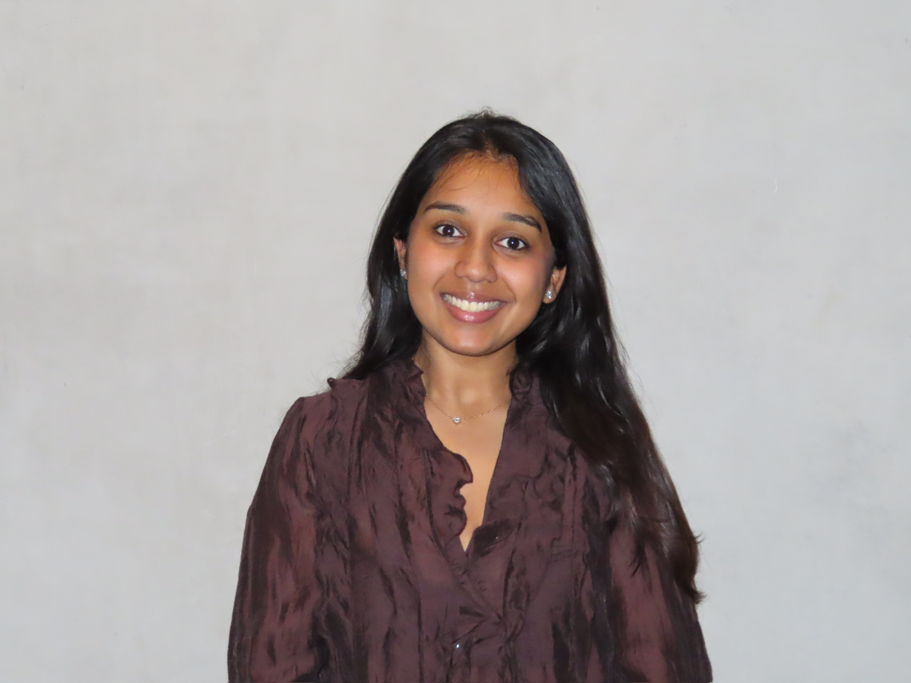

::: {.bio}

::: {.hero}

::: {.hero-text}
[Dhriti Sonthalia]{.name}

I study economics and data science at Claremont McKenna College. Most of my
work sits where valuation, education markets, and public data meet, and I care
about making the numbers legible to people who didn't build the model.

::: {.hero-links}
[Resume (PDF)](files/resume.pdf){.btn-primary-link}
[LinkedIn](https://www.linkedin.com/in/dhritisonthalia){.btn-plain-link}
[Email](mailto:dsonthalia73@cmc.edu){.btn-plain-link}
:::
:::

::: {.hero-photo}
```{=html}

```
[Claremont, CA, by way of Hyderabad]{.place}
:::

:::

::: {.now}
[Right now]{.section-label}

::: {.now-grid}
::: {.now-item}
**Senior thesis.** How board members' financial expertise shapes a firm's
dividend payout policy.
:::

::: {.now-item}
**PSYC167 project.** What changed at U.S. colleges after the shift to
test-optional admissions, told through College Scorecard data.
:::

::: {.now-item}
**Girls Into VC.** Running internal operations: chartering, budgets, and
speaker events.
:::
:::
:::

[Experience]{.section-label}

::: {.timeline}

::: {.entry}
[May – Jul 2026]{.when}

::: {.what}
[Avendus Capital]{.org} [Analyst Intern, Mumbai]{.role}

Built a three-statement model and DCF for 3M India, wrote and presented a
14-slide investment thesis, and tracked earnings and sector news for Indian
listed equities.
:::
:::

::: {.entry .ongoing}
[Jan 2026 – present]{.when}

::: {.what}
[CMC Girls Into VC]{.org} [Internal Operations Chair, Claremont]{.role}

Manage the club's chartering, compliance, and budgets, and run logistics for
speaker events and programs.
:::
:::

::: {.entry}
[Jun – Aug 2025]{.when}

::: {.what}
[JV Ventures]{.org} [Analyst Intern, Hyderabad]{.role}

Ran diligence on K-12 education infrastructure and pharma, and sized the GCC
higher-education market for investment partners.
:::
:::

::: {.entry}
[Sep 2024 – May 2025]{.when}

::: {.what}
[Lowe Institute of Political Economy]{.org} [Data Journalist, Claremont]{.role}

Analyzed firm-level and labor-market data in Stata and R on gender differences
in CEO profit orientation, and turned the findings into public-facing charts.
:::
:::

::: {.entry}
[Jun – Aug 2024]{.when}

::: {.what}
[Sourcefin]{.org} [Strategic Consulting Intern, Johannesburg]{.role}

Led a four-person team evaluating funding products for South African SMEs and
pitched five recommendations to the executive committee and board.
:::
:::

:::

::: {.lower}

::: {.lower-col}
[Education]{.section-label}

[Claremont McKenna College]{.org}
[B.A. Economics, Data Science Sequence. Expected May 2027.]{.role}

[Also involved in]{.section-label}

- Fellowship Mentor and former Handley Leadership Fellow, Kravis Leadership Institute
- Career Service Mentor, Soll Center for Student Opportunity
- Fellow, Randall Lewis Center of Innovation and Entrepreneurship
- Chief Development Officer, CMC Smart Woman Securities (2024–2026)
:::

::: {.lower-col}
[Tools]{.section-label}

Python, R, Stata, Excel, Adobe Illustrator and InDesign

[Languages]{.section-label}

English and Hindi (fluent), Spanish (intermediate), Italian (beginner)

[Off the clock]{.section-label}

I'm a professional Kathak dancer and a pianist. I also bake, play tennis, and
travel whenever the calendar allows.
:::

:::

:::
