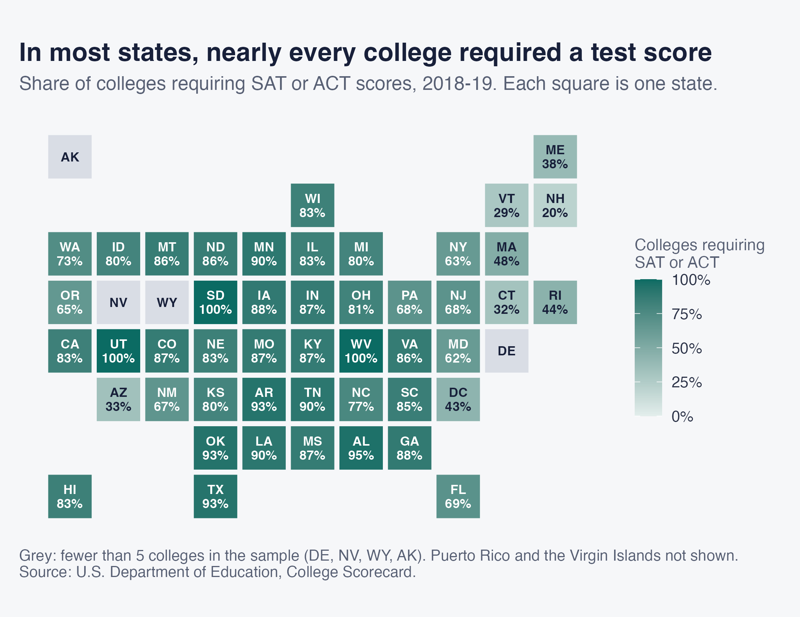
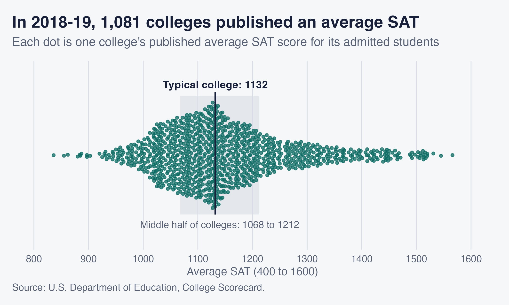
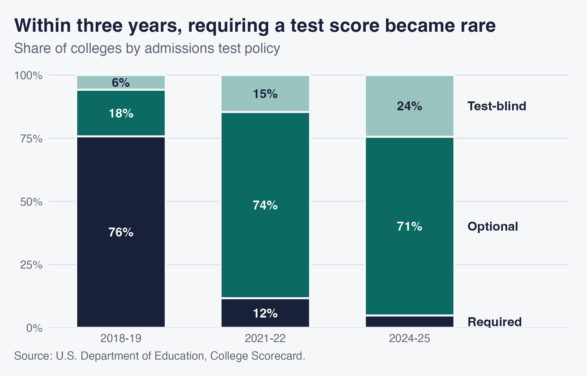
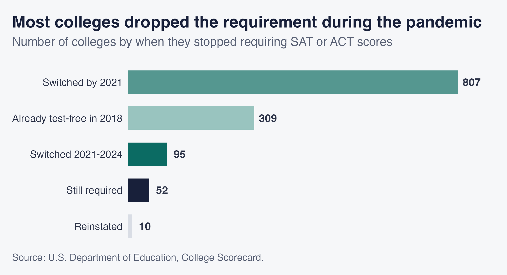

Before looking at what happened to scores, it helps to see where colleges started and how fast they moved. The first two charts show the world before the pandemic. The next two show the shift away from testing and sort colleges into the groups that the rest of the project compares.

```{r, setup}
#| message: false
#| warning: false
#| include: false

# libraries and functions --------------------------------------------------
library(here)
library(ggplot2)
library(dplyr)
library(tidyr)
source(here("pages", "project", "src", "functions", "save_plot_as_png.R"))
source(here("pages", "project", "src", "functions", "theme_dhriti.R"))

# data ---------------------------------------------------------------------
# The cleaning script reads the raw .Rds and writes the cleaned one (no API call)
source(here("pages", "project", "src", "data", "data_cleaning.R"))
scorecard <- readRDS(here("pages", "project", "data", "cleaned", "scorecard_cleaned.Rds"))

# Every chart uses the same set of colleges
d <- scorecard |> filter(analysis_sample)

# When did each college stop requiring scores? ------------------------------
# Built from the policy each college reported in 2018-19, 2021-22 and 2024-25
timing_levels <- c("Already test-free in 2018", "Switched by 2021",
                   "Switched 2021-2024", "Still required", "Reinstated")

timing <- d |>
  select(unitid, year, test_policy) |>
  mutate(test_policy = as.character(test_policy)) |>
  pivot_wider(names_from = year, values_from = test_policy, names_prefix = "y") |>
  mutate(
    timing = case_when(
      y2018 != "Required"                         ~ "Already test-free in 2018",
      y2021 != "Required" & y2024 != "Required"   ~ "Switched by 2021",
      y2021 == "Required" & y2024 != "Required"   ~ "Switched 2021-2024",
      y2021 == "Required" & y2024 == "Required"   ~ "Still required",
      y2021 != "Required" & y2024 == "Required"   ~ "Reinstated"
    ),
    timing = factor(timing, levels = timing_levels),
    # the two switch groups together = colleges that dropped the requirement
    dropped = timing %in% c("Switched by 2021", "Switched 2021-2024")
  ) |>
  select(unitid, timing, dropped)

d <- d |> left_join(timing, by = "unitid")

# One row per college, 2018-19 and 2024-25 side by side
wide <- d |>
  filter(year %in% c(2018, 2024)) |>
  mutate(p25 = satvr25 + satmt25,   # sum of the reading and math 25th percentiles
         p75 = satvr75 + satmt75) |>
  select(unitid, timing, dropped, year, sat_avg, p25, p75, adm_rate, pctpell) |>
  pivot_wider(names_from = year, values_from = c(sat_avg, p25, p75, adm_rate, pctpell))

# Colours: one teal hue, stepped in luminance (HCL) -------------------------
# The groups are ordered (how long a college kept requiring scores), so they
# get an ordered luminance ramp: darker = required longer. Each step is about
# 18+ points of HCL luminance apart, so the groups stay distinct in greyscale
# and for red-green colour blindness, where hue is lost but luminance is not.
#   L 13 ink       still requires scores
#   L 40 teal      switched 2021-2024 / test-optional / dropped the requirement
#   L 58 mid teal  switched by 2021
#   L 76 pale teal already test-free in 2018 / test-blind
#   L 88 rule grey reinstated (context only)
teal_mid   <- "#559790"
teal_light <- "#99C4BF"

policy_cols <- c("Required"   = unname(dhriti_cols["ink"]),
                 "Optional"   = unname(dhriti_cols["teal"]),
                 "Test-blind" = teal_light)
timing_cols <- c("Already test-free in 2018" = teal_light,
                 "Switched by 2021"          = teal_mid,
                 "Switched 2021-2024"        = unname(dhriti_cols["teal"]),
                 "Still required"            = unname(dhriti_cols["ink"]),
                 "Reinstated"                = unname(dhriti_cols["rule"]))

src_caption <- "Source: U.S. Department of Education, College Scorecard."
```

# Part 1: Before the pandemic

## Chart 1: Testing was the norm

```{r, plot-ch01-state-map}
#| echo: false
#| message: false
#| warning: false

# Tile map: one equal-sized square per state so small states stay readable
state_grid <- tibble::tribble(
  ~stabbr, ~col, ~row,
  "AK", 0, 0, "ME", 10, 0,
  "WI", 5, 1, "VT", 9, 1, "NH", 10, 1,
  "WA", 0, 2, "ID", 1, 2, "MT", 2, 2, "ND", 3, 2, "MN", 4, 2, "IL", 5, 2,
  "MI", 6, 2, "NY", 8, 2, "MA", 9, 2,
  "OR", 0, 3, "NV", 1, 3, "WY", 2, 3, "SD", 3, 3, "IA", 4, 3, "IN", 5, 3,
  "OH", 6, 3, "PA", 7, 3, "NJ", 8, 3, "CT", 9, 3, "RI", 10, 3,
  "CA", 0, 4, "UT", 1, 4, "CO", 2, 4, "NE", 3, 4, "MO", 4, 4, "KY", 5, 4,
  "WV", 6, 4, "VA", 7, 4, "MD", 8, 4, "DE", 9, 4,
  "AZ", 1, 5, "NM", 2, 5, "KS", 3, 5, "AR", 4, 5, "TN", 5, 5, "NC", 6, 5,
  "SC", 7, 5, "DC", 8, 5,
  "OK", 3, 6, "LA", 4, 6, "MS", 5, 6, "AL", 6, 6, "GA", 7, 6,
  "HI", 0, 7, "TX", 3, 7, "FL", 8, 7
)

min_state_n <- 5  # states with fewer colleges than this are shown in grey

state_req_2018 <- d |>
  filter(year == 2018) |>
  group_by(stabbr) |>
  summarise(n = n(), share_required = mean(test_policy == "Required"),
            .groups = "drop") |>
  right_join(state_grid, by = "stabbr") |>          # keeps the 50 states + DC only
  mutate(
    share_plot = ifelse(!is.na(n) & n >= min_state_n, share_required, NA),
    label = ifelse(is.na(share_plot), stabbr,
                   paste0(stabbr, "\n", round(100 * share_plot), "%"))
  )

grey_states <- paste(state_req_2018$stabbr[is.na(state_req_2018$share_plot)],
                     collapse = ", ")

p <- state_req_2018 |>
  ggplot(aes(x = col, y = -row)) +
  geom_tile(aes(fill = share_plot), colour = dhriti_cols["paper"], linewidth = 1.5) +
  geom_text(aes(label = label, colour = !is.na(share_plot) & share_plot > 0.5),
            size = 2.9, lineheight = 0.9, fontface = "bold", show.legend = FALSE) +
  scale_fill_gradient(low = dhriti_seq[1], high = dhriti_seq[2],
                      na.value = dhriti_cols["rule"],
                      limits = c(0, 1), labels = scales::percent,
                      name = "Colleges requiring\nSAT or ACT") +
  scale_colour_manual(values = c("TRUE" = "white", "FALSE" = unname(dhriti_cols["ink"]))) +
  coord_equal() +
  labs(
    # TODO: your headline
    title = "In most states, nearly every college required a test score",
    subtitle = "Share of colleges requiring SAT or ACT scores, 2018-19. Each square is one state.",
    caption = paste0("Grey: fewer than ", min_state_n, " colleges in the sample (",
                     grey_states, "). Puerto Rico and the Virgin Islands not shown.\n",
                     src_caption)
  ) +
  theme_dhriti(grid = "none") +
  theme(
    axis.text = element_blank(), axis.title = element_blank(),
    panel.grid.major = element_blank(),
    legend.position = "right", legend.justification = "center",
    legend.title = element_text(colour = dhriti_cols["muted"], size = rel(0.85))
  )
```

```{r, saveplot-ch01-state-map}
#| message: false
#| warning: false
#| include: false

save_plot_as_png(plot = p, file_name = "01-state-map-2018.png", height = 5.4)
```

{width=85% fig-alt="Tile map of the United States, one square per state, shaded by the share of colleges requiring SAT or ACT scores in 2018-19. Most states are between 80% and 100%. New England states are much lower: New Hampshire 20%, Vermont 29%, Connecticut 32%, Maine 38%. Alaska, Nevada, Wyoming and Delaware are grey because they have fewer than five colleges in the sample."}

In 2018-19, 76% of the colleges in this project required an SAT or ACT score. Public colleges were the most likely to require one (88%), but most private nonprofit colleges did too (69%). In South Dakota, Utah and West Virginia, every college in the sample required a score, and much of the South and Midwest was above 90%.

The clear exception was New England. Only 20% of colleges in New Hampshire required a score, along with 29% in Vermont, 32% in Connecticut and 38% in Maine. The region is home to many small private liberal arts colleges, a group that had been moving away from testing for years before the pandemic. Outside New England, only Arizona and Washington, D.C. were below half, and both have fewer than ten colleges in the sample.

So for most students in most states, sending a score was simply part of applying. That is the baseline the rest of the project measures against.

## Chart 2: What reported scores looked like then

```{r, plot-ch02-sat-beeswarm}
#| echo: false
#| message: false
#| warning: false

sat_2018 <- d |> filter(year == 2018, !is.na(sat_avg))

sat_2018_med <- median(sat_2018$sat_avg)
sat_2018_q   <- quantile(sat_2018$sat_avg, c(0.25, 0.75))

p <- sat_2018 |>
  ggplot(aes(x = sat_avg, y = 0)) +
  # middle half of colleges, drawn as a light band behind the dots
  annotate("rect", xmin = sat_2018_q[1], xmax = sat_2018_q[2],
           ymin = -0.47, ymax = 0.47, fill = dhriti_cols["rule"], alpha = 0.6) +
  ggbeeswarm::geom_quasirandom(orientation = "y", width = 0.42,
                               colour = dhriti_cols["teal"], size = 1.1, alpha = 0.75) +
  annotate("segment", x = sat_2018_med, xend = sat_2018_med, y = -0.47, yend = 0.5,
           colour = dhriti_cols["ink"], linewidth = 0.8) +
  annotate("text", x = sat_2018_med, y = 0.53, vjust = 0, size = 3.7, fontface = "bold",
           colour = dhriti_cols["ink"],
           label = paste0("Typical college: ", round(sat_2018_med))) +
  annotate("text", x = mean(sat_2018_q), y = -0.52, vjust = 1, size = 3.4,
           colour = dhriti_cols["muted"],
           label = paste0("Middle half of colleges: ", round(sat_2018_q[1]), " to ",
                          round(sat_2018_q[2]))) +
  scale_x_continuous(limits = c(800, 1600), breaks = seq(800, 1600, 100)) +
  scale_y_continuous(limits = c(-0.68, 0.68)) +
  labs(
    # TODO: your headline
    title = paste0("In 2018-19, ", format(nrow(sat_2018), big.mark = ","),
                   " colleges published an average SAT"),
    subtitle = "Each dot is one college's published average SAT score for its admitted students",
    x = "Average SAT (400 to 1600)", y = NULL, caption = src_caption
  ) +
  theme_dhriti(grid = "x") +
  theme(axis.text.y = element_blank())
```

```{r, saveplot-ch02-sat-beeswarm}
#| message: false
#| warning: false
#| include: false

save_plot_as_png(plot = p, file_name = "02-sat-beeswarm-2018.png", height = 4.2)
```

{width=80% fig-alt="Beeswarm plot with one dot for each of 1,081 colleges, placed by the average SAT score it published in 2018-19. Dots range from about 840 to 1570. A vertical line marks the typical college at 1132, and a shaded band marks the middle half of colleges, from 1068 to 1212. A thinner tail of colleges stretches above 1300."}

Each college reports an average SAT score for the students it admits, with ACT scores converted to the SAT scale. In 2018-19, 1,081 colleges in the sample published one. The typical (median) college reported 1132, and the middle half of colleges fell between 1068 and 1212, a range of less than 150 points. The lowest average was 836 and the highest was 1566. Only a small group of highly selective colleges sits above 1300.

Because most of these colleges required a score, the averages in this chart mostly describe everyone they admitted. That is what makes 2018-19 a useful reference point. When a score becomes optional, the same number starts to describe only the students who chose to send one.

# Part 2: The shift

## Chart 3: Requirements collapsed

```{r, plot-ch03-policy-mix}
#| echo: false
#| message: false
#| warning: false

policy_mix <- d |>
  count(academic_year, test_policy) |>
  group_by(academic_year) |>
  mutate(share = n / sum(n)) |>
  ungroup() |>
  # "Required" first so it sits on the baseline, where it is easiest to compare
  mutate(test_policy = factor(test_policy, levels = c("Required", "Optional", "Test-blind"))) |>
  arrange(academic_year, test_policy) |>
  group_by(academic_year) |>
  mutate(ypos = cumsum(share) - share / 2) |>
  ungroup()

# direct labels for the policy names, placed beside the last bar
last_bar <- policy_mix |>
  filter(academic_year == max(academic_year)) |>
  arrange(test_policy) |>
  mutate(y = cumsum(share) - share / 2)

p <- policy_mix |>
  ggplot(aes(x = academic_year, y = share, fill = test_policy)) +
  geom_col(width = 0.62, colour = dhriti_cols["paper"], linewidth = 0.8,
           position = position_stack(reverse = TRUE)) +
  # percentages: white on the dark segments, ink on the pale one (contrast)
  geom_text(data = filter(policy_mix, share >= 0.05, test_policy != "Test-blind"),
            aes(y = ypos, label = scales::percent(share, accuracy = 1)),
            colour = "white", size = 3.8, fontface = "bold") +
  geom_text(data = filter(policy_mix, share >= 0.05, test_policy == "Test-blind"),
            aes(y = ypos, label = scales::percent(share, accuracy = 1)),
            colour = dhriti_cols["ink"], size = 3.8, fontface = "bold") +
  geom_text(data = last_bar, aes(x = 3.4, y = y, label = test_policy),
            hjust = 0, size = 3.8, fontface = "bold", colour = dhriti_cols["ink"],
            inherit.aes = FALSE) +
  scale_fill_manual(values = policy_cols) +
  scale_y_continuous(labels = scales::percent, expand = expansion(mult = c(0, 0.02))) +
  scale_x_discrete(expand = expansion(add = c(0.5, 1.1))) +
  labs(
    # TODO: your headline
    title = "Within three years, requiring a test score became rare",
    subtitle = "Share of colleges by admissions test policy",
    x = NULL, y = NULL, caption = src_caption
  ) +
  theme_dhriti() +
  theme(legend.position = "none")
```

```{r, saveplot-ch03-policy-mix}
#| message: false
#| warning: false
#| include: false

save_plot_as_png(plot = p, file_name = "03-policy-mix.png")
```

{width=80% fig-alt="Stacked bar chart of the share of colleges by test policy in 2018-19, 2021-22 and 2024-25, with Required on the bottom. Required falls from 76% to 12% to 5%. Optional grows from 18% to 74% to 71%, and test-blind from 6% to 15% to 24%."}

The shift was fast. The share of colleges requiring a test score fell from 76% in 2018-19 to 12% in 2021-22, and then to 5% by 2024-25. In three admissions cycles, a requirement that had been the norm became uncommon.

Most colleges did not stop using scores altogether. They made them optional: 74% of colleges were test-optional in 2021-22 and 71% in 2024-25. The share that does not consider scores at all, shown here as test-blind, grew more slowly, from 6% to 15% to 24%.

The difference matters for this project. A test-optional college still accepts scores and still reports an average, but only from the applicants who decided to submit. Since test-optional colleges are now the large majority, most published averages now come from a group of students that each applicant chose to join or not.

## Chart 4: Colleges switched at different times

```{r, plot-ch04-switch-timing}
#| echo: false
#| message: false
#| warning: false

timing_n <- d |>
  distinct(unitid, timing) |>
  count(timing) |>
  mutate(timing = forcats::fct_reorder(timing, n))

p <- timing_n |>
  ggplot(aes(x = n, y = timing, fill = timing)) +
  geom_col(width = 0.65) +
  geom_text(aes(label = format(n, big.mark = ",")), hjust = -0.25,
            size = 3.8, fontface = "bold", colour = dhriti_cols["body"]) +
  scale_fill_manual(values = timing_cols) +
  scale_x_continuous(expand = expansion(mult = c(0, 0.1))) +
  labs(
    # TODO: your headline
    title = "Most colleges dropped the requirement during the pandemic",
    subtitle = "Number of colleges by when they stopped requiring SAT or ACT scores",
    x = "Number of colleges", y = NULL, caption = src_caption
  ) +
  theme_dhriti(grid = "none") +
  theme(legend.position = "none", panel.grid.major = element_blank(),
        axis.text.x = element_blank(), axis.title.x = element_blank(),
        axis.text.y = element_text(size = rel(1.05), colour = dhriti_cols["body"]))
```

```{r, saveplot-ch04-switch-timing}
#| message: false
#| warning: false
#| include: false

save_plot_as_png(plot = p, file_name = "04-switch-timing.png", height = 3.8)
```

{width=80% fig-alt="Horizontal bar chart of the number of colleges by when they stopped requiring test scores. 807 switched by 2021-22, 309 were already test-free in 2018-19, 95 switched between 2021-22 and 2024-25, 52 still require scores, and 10 dropped the requirement and then reinstated it."}

Not every college made the change at the same time, and the timing is what lets us compare them. Of the 1,273 colleges, 807 (63%) dropped their requirement by 2021-22, in the first cycles after the pandemic began. Another 309 (24%) were already test-free before it started. A smaller group of 95 (7%) held on through 2021-22 and dropped the requirement by 2024-25. Just 52 colleges (4%) required scores in all three years, and 10 dropped the requirement and then brought it back.

The rest of the project compares these groups. The 52 colleges that still require scores matter most, even though they are few. Every admitted student at these colleges still has a score, so their averages show what happened to scores when nothing changed about who reports them. Most of them are public, as are 8 of the 10 colleges that reinstated a requirement. The reinstated group is too small to analyze, so it is set aside in the later comparisons. Some later charts also combine the two switch groups as colleges that "dropped the requirement."

If optional testing pushed published averages up, scores should rise wherever sending them was optional and should not rise where it was required.

[← Back to the introduction](index.qmd)

Data: U.S. Department of Education, [College Scorecard](https://collegescorecard.ed.gov/), accessed through the `rscorecard` package.
